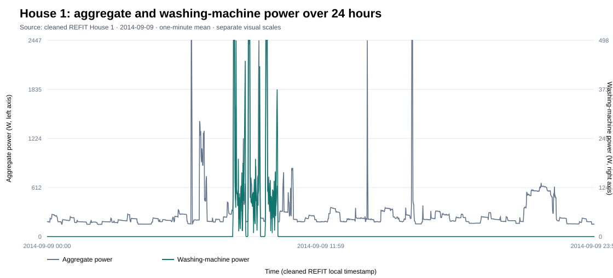
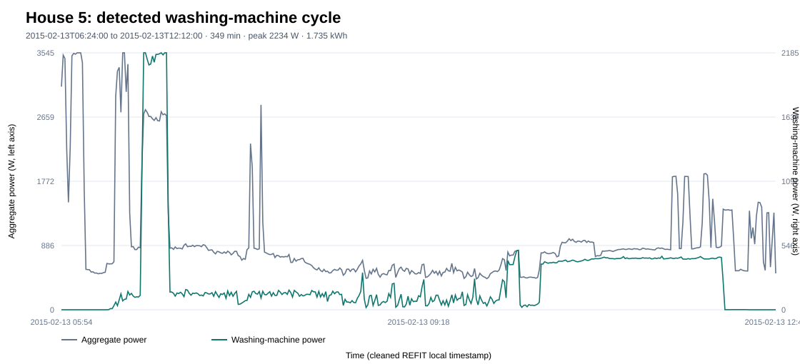
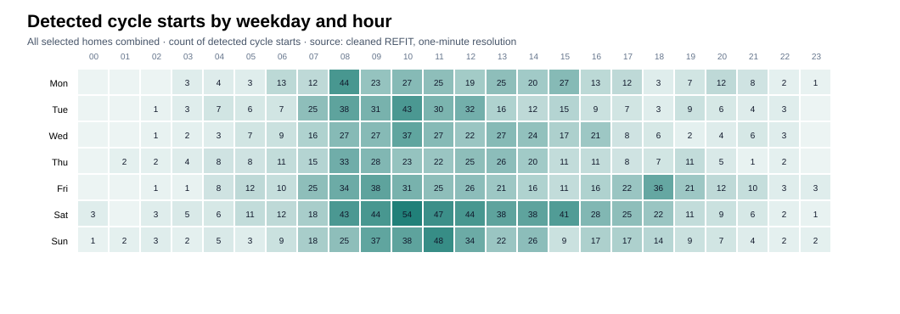
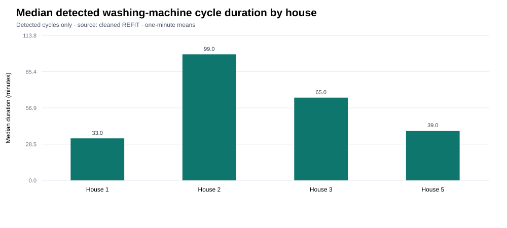
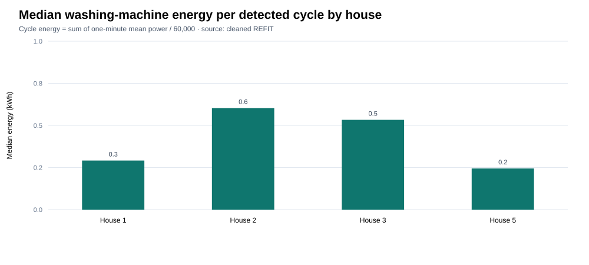
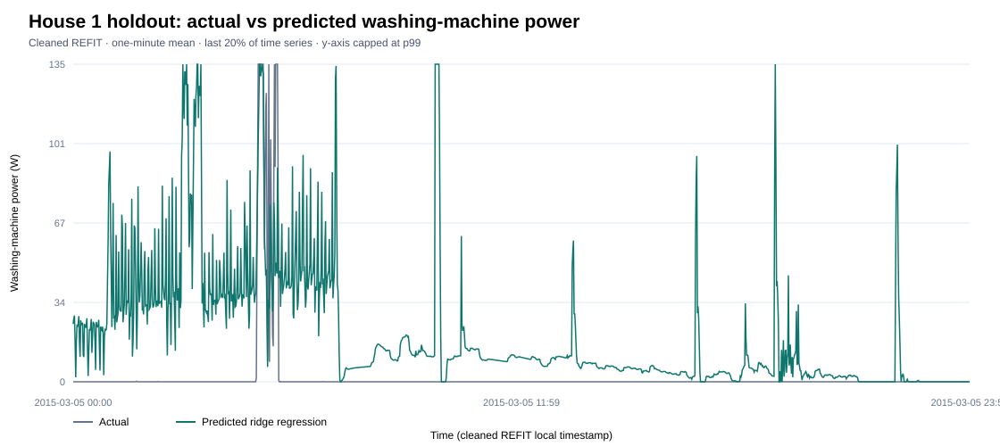

# Washing-machine exploratory analysis

## Data and method

This analysis uses the official cleaned REFIT files for Houses 1, 2, 3, and 5.
The washing-machine channels are Appliance5, Appliance2, Appliance6, and
Appliance3, respectively, according to `data/raw/CLEAN_READ_ME_081116.txt`.
House 1 also has a separate washer-dryer channel; this analysis uses the
channel identified as its washing machine.

Readings are active power in watts at approximately 8-second resolution. The
cleaned `Time` field was resampled to one-minute arithmetic means. Minutes with
no source reading remain missing. The cleaned `Issues` flag marks records
where the appliance-monitor sum exceeds aggregate power; those records are
kept for this descriptive analysis and their frequency is reported below.

### Cycle detection rule

A detected cycle is a run of 10 to 360 minutes where the washing-machine
channel is at least 10 W. Gaps of up to two minutes below the threshold are
bridged. A run must reach at least 100 W in one minute. Segments longer than
six hours are excluded as likely sensor or data anomalies. This is a simple
event heuristic; the dataset does not provide verified wash-cycle labels.
Cycle duration includes bridged short gaps. Energy per event is the sum of
one-minute mean power over the event, converted to kWh.

## Availability and detected use

- **House 1 (Appliance5):** 2013-10-09 to 2015-07-10; 920,091 minute bins,
  with 116,318 missing washing-machine minutes (12.64%). Exact zero readings
  account for 97.56% of valid minutes; readings below 10 W account for 97.98%.
  The rule detects 469 cycles.
- **House 2 (Appliance2):** 2013-09-17 to 2015-05-28; 889,078 minute bins,
  with 218,914 missing minutes (24.62%). Exact zero readings account for
  94.39% of valid minutes; readings below 10 W account for 94.99%. The rule
  detects 348 cycles.
- **House 3 (Appliance6):** 2013-09-25 to 2015-06-02; 885,095 minute bins,
  with 100,693 missing minutes (11.38%). Exact zero readings account for
  93.11% of valid minutes; readings below 10 W account for 94.24%. The rule
  detects 709 cycles.
- **House 5 (Appliance3):** 2013-09-26 to 2015-07-06; 933,593 minute bins,
  with 87,220 missing minutes (9.34%). Exact zero readings account for 52.12%
  of valid minutes; readings below 10 W account for 91.58%. The rule detects
  910 cycles after excluding 30 active segments longer than six hours (25 also
  met the other cycle criteria).

Across these homes the rule detects 2,436 events. The highest detected start
hour is 10:00 (254 starts), and Saturday is the most common start day (517
starts). These are counts across the selected records; differences in coverage
and outages mean they should be read as descriptive patterns, not household
population estimates.

## Cross-house comparison

- House 1: median detected duration 33 minutes; median energy 0.292 kWh.
- House 2: median detected duration 99 minutes; median energy 0.603 kWh.
- House 3: median detected duration 65 minutes; median energy 0.533 kWh.
- House 5: median detected duration 39 minutes; median energy 0.244 kWh.

House 2 has the longest median event and the highest median event energy in
this sample. House 5 has the shortest median energy. These values depend on
the event rule and the households' appliance models and routines.











## Appliance-disaggregation model

The model is a ridge regression that predicts washing-machine power from
whole-home aggregate power at the current minute, recent aggregate lags and
rolling means, the one-minute aggregate change, and hour/day cyclic features.
It pools training rows across the four selected homes. The chronological split
is 70% training, the next 10% validation, and the final 20% test within each
home. Test periods are House 1: 2015-03-04 to 2015-07-10; House 2:
2015-01-24 to 2015-05-28; House 3: 2015-01-30 to 2015-06-02; House 5:
2015-02-27 to 2015-07-06. Rows with missing inputs or target readings are
excluded, as are minute bins with the REFIT `Issues` flag above zero. Training
was capped at a reproducible random sample of 300,000 usable minutes.

On the pooled held-out test minutes:

- The always-off baseline has MAE 18.68 W and RMSE 158.97 W.
- Ridge regression has MAE 28.49 W and RMSE 152.48 W. Its RMSE is about 4.1%
  lower, while its MAE is higher because it predicts small loads during many
  inactive minutes.
- Ridge regression has active-minute F1 0.149 at a 100 W threshold, with
  precision 0.193 and recall 0.121. Its predicted total energy is 73.1% of
  actual test energy.

The always-off baseline remains stronger on MAE, and the model misses most
active minutes. A 500 W zero cutoff selected for lowest validation MAE nearly
eliminated activity detections, so it was rejected. The unthresholded model is
retained as the model result because it reduces RMSE, but its energy estimate
is low and it is not accurate enough for customer-level event alerts.



## Limitations and interpretation

- House 2 has the largest share of missing minute bins, so its event count may
  be understated. Missing minutes are not filled for this analysis.
- The cleaned-data `Issues` flag is set for 0.84% of House 1 source rows,
  0.50% of House 2, 5.84% of House 3, and 5.73% of House 5. The readings were
  retained and flagged for EDA; minute bins with the flag are excluded from
  model training and evaluation.
- House 5 contains 30 active segments longer than six hours; the longest spans
  about 46.8 hours. The six-hour cap removes these from cycle counts, but
  remaining event counts still depend on this heuristic.
- A real wash can have longer pauses than the two-minute merge allowance and
  be split into separate detected events. Short events, events below 100 W
  peak, and unusual long programs may also be missed or miscounted.
- Aggregate power is an ambiguous input: other appliances can create similar
  peaks, while the ridge model smooths distinct wash, heat, and spin phases.
  Its low F1 and worse MAE than always-off show these limits in this
  evaluation.
- The four households are a small UK sample. These results do not establish
  typical usage for other regions, including India.

## Reproducibility

From the repository root, run:

```bash
python src/explore_washing_machine.py
```

The script reads `CLEAN_House1.csv`, `CLEAN_House2.csv`, `CLEAN_House3.csv`,
and `CLEAN_House5.csv` from `data/CLEAN_REFIT_081116/` when that extracted
dataset folder is present. Otherwise, place those four files directly in
`data/processed/`.

Use `--reuse-minute-data` to recalculate event detection and plots from the
already generated one-minute files after changing the detection rule. The
script writes detailed coverage and cross-house summaries to
`reports/washing_machine_eda.json`, event records to
`reports/washing_machine_cycles.csv`, figures to `reports/figures/`, and
derived one-minute series to `data/processed/washing_machine_1min/`.

Run the disaggregation model with:

```bash
python src/model_washing_machine.py
```

It writes test metrics to `reports/model_metrics.json`, a House 1 held-out
trace to `reports/model_predictions_house1_24h.csv`, and the actual-versus-
predicted plot to `reports/figures/model_actual_vs_pred_house1.svg`.
